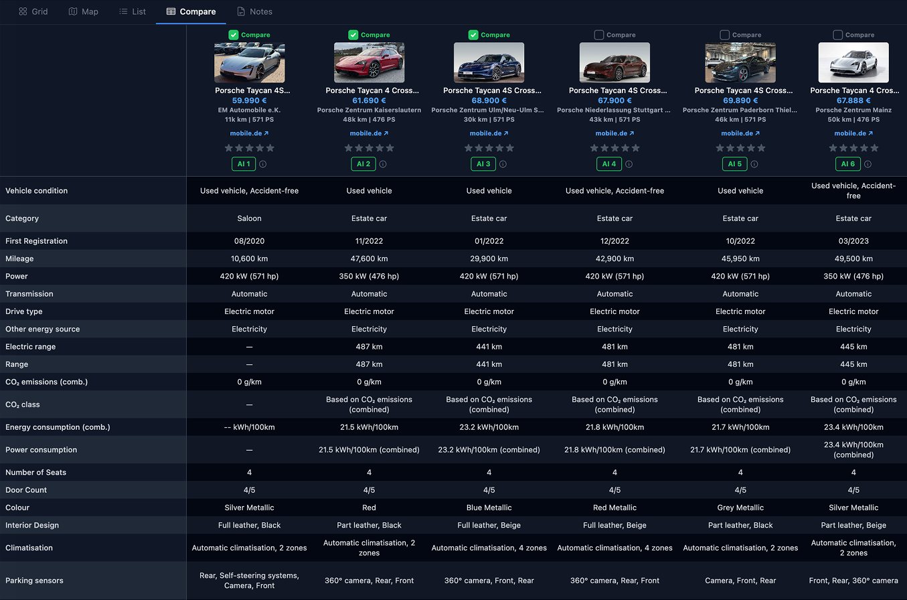

# [Garageview.ai](https://garageview.ai)

**Let’s build the best platform for comparing and choosing cars—together.**

Collect new and used car listings from **mobile.de, AutoScout24 and Otomoto** in one place. Compare your shortlist and choose with more confidence.

[Try Garageview](https://garageview.ai) · [Watch demo](https://www.youtube.com/watch?v=-SxWbA7cpR4) · [Buying guides](https://garageview.ai/en/guides/) · [Share an idea](https://github.com/SergeyKorolev/garageview/discussions)

## What you can do

- Compare prices, mileage and equipment.
- Organize collections, keep notes and share cars with others.
- Use AI analysis to explore options and prepare seller questions.
- Save mobile.de listings with the Chrome extension, or paste links from all three marketplaces into the web app.

Available in English, German, French, Spanish, Italian, Polish and Ukrainian. Garageview is independent of the marketplaces it supports.

## Screenshots

**Your car collection**


**Compare cars side by side**



## Contribute

Bring your ideas, code, design skills, translations or car-buying experience. You don’t need to write code to help.

[Report a problem](https://github.com/SergeyKorolev/garageview/issues), join a discussion, or open a pull request. See [CONTRIBUTING.md](CONTRIBUTING.md) to get started.

## Tech stack

- **Backend:** Rails 8.0, Ruby 3.3.10, PostgreSQL 16, Redis 7, Sidekiq
- **Frontend:** React 19, TypeScript, React Router, Zustand, TanStack Query, Tailwind CSS 4
- **Build:** esbuild (JS/TS), Tailwind CLI (CSS)
- **Auth:** Devise + Google OAuth2
- **AI:** OpenAI (gpt-4o, gpt-4o-mini)
- **Transactional email:** [Mailtrap](https://mailtrap.io) Email Sending API with hosted templates (see below)
- **Chrome extension:** Manifest V3, content scripts on mobile.de
- **Deploy:** Kamal 2, Docker

### Email sending with Mailtrap templates

Transactional email goes through the Mailtrap Email Sending API using the official [`mailtrap` gem](https://github.com/railsware/mailtrap-ruby). Emails are not rendered in the app: each message is a Mailtrap-hosted template referenced by UUID, with variables filled in at send time, so copy and design changes never require a deploy. The integration lives in [`app/services/mailtrap_email_service.rb`](app/services/mailtrap_email_service.rb) and sends the welcome, collection invite and account deleted emails via `Mailtrap::Mail::FromTemplate`:

```ruby
mail = Mailtrap::Mail::FromTemplate.new(
  from: { email: FROM_EMAIL, name: FROM_NAME },
  to: [{ email: user.email, name: user.name }],
  template_uuid: ENV["MAILTRAP_WELCOME_TEMPLATE_UUID"],
  template_variables: { "user_name" => user.name, "app_url" => APP_URL }
)
Mailtrap::Client.new(api_key: ENV["MAILTRAP_API_TOKEN"]).send(mail)
```

In production the client delivers for real with `MAILTRAP_API_TOKEN`; in development it runs in sandbox mode, so emails land in a Mailtrap testing inbox instead of real mailboxes. Missing template UUIDs or API token are logged and skipped, never raised, so email can't break a signup or invite flow.

## Run locally

Requires Ruby **3.3.10**, Node **24.14.0**, Docker Compose and native build tools.

```sh
cp .env.example .env
docker compose up -d db redis
bin/setup
npm run build
npm run build:css
bin/dev
```

Open [localhost:3000/en](http://localhost:3000/en) and [create a local account](http://localhost:3000/users/sign_up). Live imports and AI features require your own API credentials; demo data and core collection screens do not.

[Demo data, tests and architecture](docs/development.md) · [Editing guides](blog/README.md) · [Self-hosting](docs/self-hosting.md) · [Security](SECURITY.md)

## License

[MIT](LICENSE). Third-party material retains its own rights; see [NOTICE.md](NOTICE.md).
